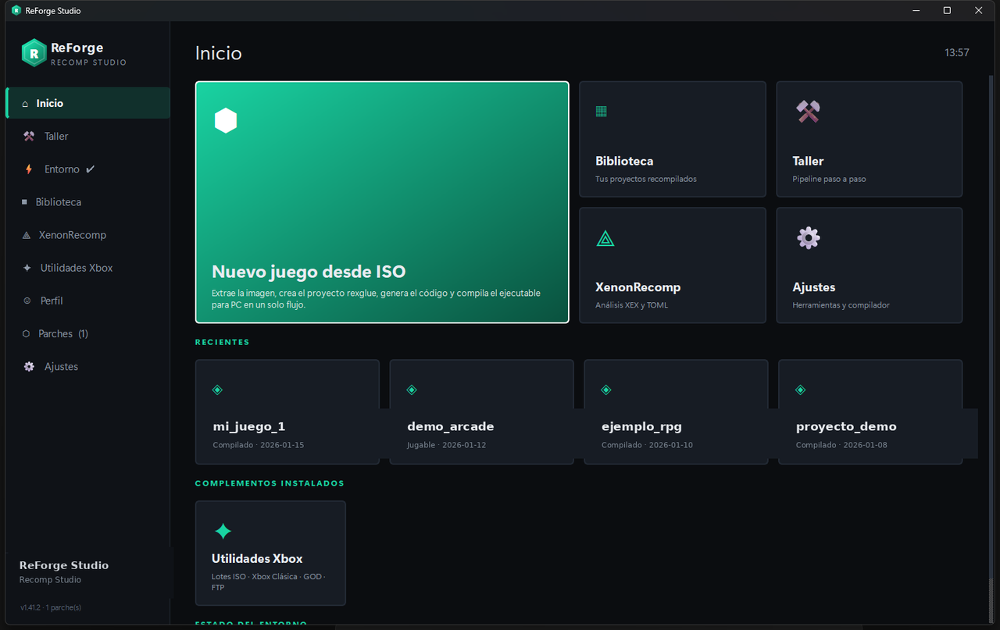
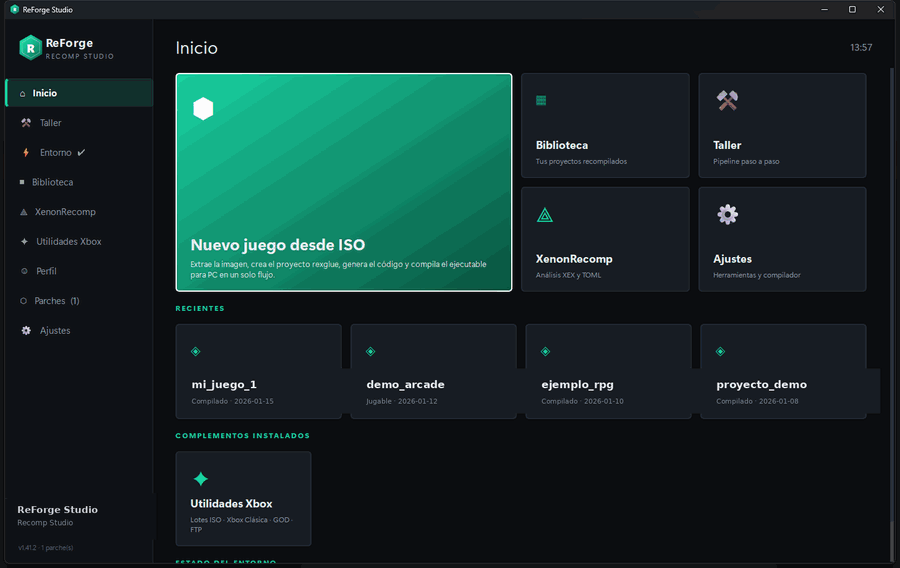
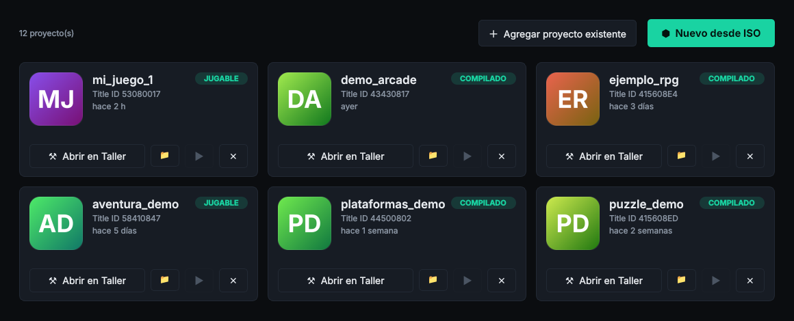
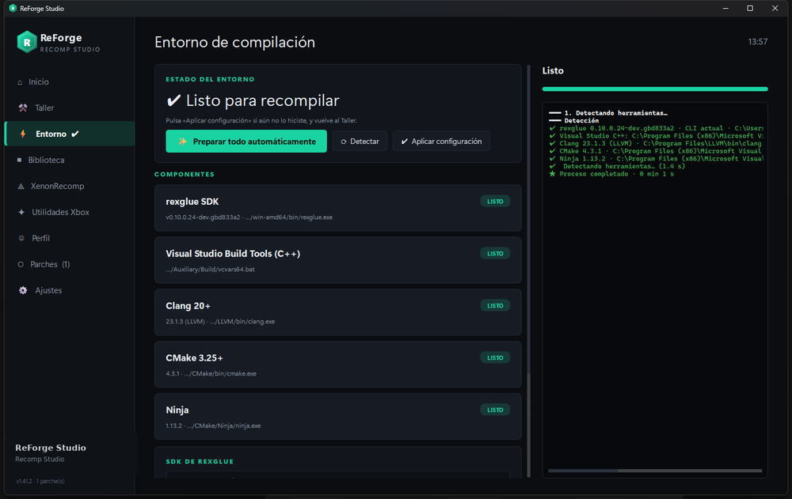
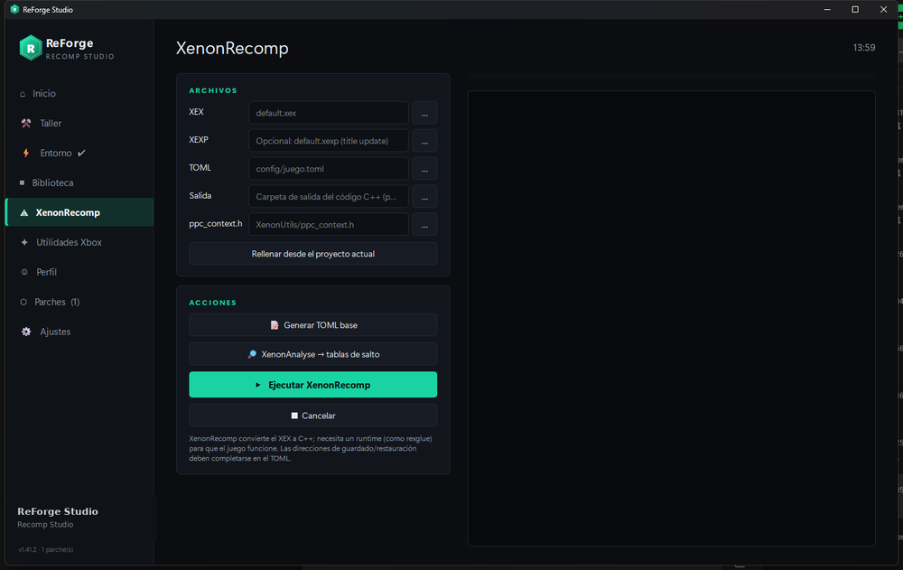

<div align="center">



**Recompila juegos de Xbox 360 a PC desde una interfaz de escritorio — sin pelearte con la terminal.**

[](https://github.com/RFC12/reforge-studio/releases)
[](#instalación)
[](#desarrollo)
[](https://github.com/rexglue/rexglue-sdk)
[](#)

</div>

> [!NOTE]
> Proyecto independiente, sin relación con Microsoft ni Xbox. Úsalo solo con juegos que poseas legalmente.

ReForge Studio pone todo el flujo de **recompilación estática** (del código máquina PowerPC del Xbox 360 a
un `.exe` x64 nativo) detrás de una interfaz clara: extraer la ISO, crear el proyecto, generar el código,
compilar, configurar y jugar. Por debajo usa [rexglue](https://github.com/rexglue/rexglue-sdk) y
[XenonRecomp](https://github.com/hedge-dev/XenonRecomp), y es ampliable con **parches**.

<div align="center">

</div>

---

## ✨ Qué hace

| | |
|---|---|
| 🧩 **Flujo guiado** | Del ISO al `.exe` en seis pasos, con el estado de cada uno y correcciones automáticas. |
| ⚙️ **Entorno autoconfigurado** | Detecta y prepara rexglue, Visual Studio Build Tools, Clang, CMake y Ninja. |
| 🗃️ **Base de compatibilidad por juego** | Config idónea de imagen y efectos por Title ID, ampliable; aprende de cada juego que confirmas y enlaza la ficha de Xenia como referencia. |
| 🩹 **Autofix del codegen** | Resuelve solo las funciones sin acotar (las «líneas vacías» del `functions.toml`) y otros fallos típicos, sin edición manual. |
| 🎮 **Listo para jugar** | Teclado y ratón, mandos (incl. DualSense), panorámica *hor+* y escalado FSR/CAS según el juego. |
| 🖥️ **Renderer y shaders** | Elige Direct3D 12 o Vulkan por juego y precompila shaders (AOT) para que vaya fluido desde el primer frame. |
| 🔌 **Sistema de parches** | Añade funciones con archivos `.rfpatch` verificados por SHA-256, aislados y reversibles. |

## 🎬 En acción

<div align="center">

</div>

### Biblioteca con carátulas

Cada juego recompilado aparece con su **carátula real** (la imagen del título embebida en el XEX) y su estado:

<div align="center">

</div>

## 🔧 Cómo funciona el Taller

El pipeline, paso a paso, dentro de la pestaña **Taller**:

```
Juego → assets   →   Verificar XEX   →   rexglue init   →   CMake   →   Codegen   →   Compilar
 (extraer ISO)       (default.xex)      (crear proyecto)   (configurar)  (PPC→C++)    (.exe x64)
```

1. **Juego → assets** — extrae la ISO (GOD/XBLA/Xbox Clásica) a la carpeta del proyecto.
2. **Verificar XEX** — comprueba `default.xex` y lee el Title ID.
3. **Crear proyecto** — `rexglue init --xex-path assets/default.xex …`.
4. **Configurar** — `cmake … -DCMAKE_BUILD_TYPE=Release` con el SDK.
5. **Codegen** — traduce el código PowerPC a C++ (`<nombre>_codegen`). El **autofix** declara y acota solas las funciones que rexglue no resuelve.
6. **Compilar** — `cmake --build --parallel` → ejecutable de PC.

<div align="center">


</div>

## 📦 Instalación

1. Ejecuta **`build_release.bat`** una vez (en un PC con Python 3.11+): genera `dist\ReForgeStudio-Setup-<versión>.exe`.
2. Abre el instalador, elige carpetas y deja marcada la descarga del SDK de rexglue.
3. En la app: **Entorno → «Preparar todo automáticamente»** instala con winget lo que falte (Build Tools, LLVM).

**Actualizar** es atómico: se prepara la versión nueva aparte y solo entonces se intercambia; si algo falla, la
anterior queda intacta. Tus proyectos, ajustes y parches viven en `%APPDATA%\ReForgeStudio` y nunca se tocan.

```
ReForgeStudio-Setup-<versión>.exe --silent [--dir RUTA] [--workspace RUTA] [--sdk] [--no-desktop] [--force]
```

## 🩹 Parches

Un parche es un archivo **`.rfpatch`** que añade secciones y funciones **sin modificar el programa**. No puede
romper la app: cada archivo se verifica con SHA-256, declara la versión del núcleo y la API que necesita, y si
falla al cargar se aísla y se retira solo. *Parches → Reiniciar en modo seguro* (o **Shift** al abrir) arranca
sin ninguno.

Incluido: **Utilidades Xbox** — extracción/creación de ISOs por lotes (360 y Xbox Clásica), envío por FTP a la
consola y herramientas de terceros desde tu carpeta `x_tool`.

<details>
<summary>Crear tu propio parche</summary>

```
patches/mi_parche/
  manifest.json      ← id, versión, api, requires_core
  plugin.py          ← define register(api)
```

```python
def register(api):
    page = api.ui.QtWidgets.QLabel("¡Hola desde mi parche!")
    api.add_page("main", "★  Mi parche", "Mi parche", page)
    api.add_home_tile("★", "Mi parche", "Descripción corta", lambda: api.go("main"))
```

Empaquetar: `python tools\make_patch.py patches\mi_parche -o dist\patches` (calcula los SHA-256 y verifica el
resultado). La API v1 (`reforge/plugin_api.py`) ofrece `add_page`, `add_home_tile`, `go`, `notify`, `settings`,
`data_dir`, componentes visuales (`api.ui`), tareas en segundo plano (`api.runner`) y lectores de ISO/XEX
(`api.formats`).
</details>

## 🛠️ Desarrollo

Requiere **Python 3.11+**.

```bash
python -m pip install -r requirements.txt
python main.py                 # ejecutar desde el código
python tests/test_empty_funcs.py   # autofix de líneas vacías
```

| Script | Resultado |
|---|---|
| `build_release.bat` | Instalador + parches (lo recomendado; corre los tests antes de compilar) |
| `build_exe.bat` | `.exe` portable de un solo archivo |
| `build_patches.bat` | Solo los `.rfpatch` |

Atajos: `F11` pantalla completa · `Ctrl+1…9` secciones · flechas + `Enter` en los tiles.

## 📜 Historial de versiones

Lo más reciente es **1.45.1** (cerrar el juego ya no lo reabre solo; candado de FPS por juego).
El detalle de cada versión está en [`CHANGELOG.md`](CHANGELOG.md).

## 🙏 Créditos

Construido sobre [rexglue-sdk](https://github.com/rexglue/rexglue-sdk) y
[XenonRecomp](https://github.com/hedge-dev/XenonRecomp). Las mejoras de compatibilidad para PC provienen del
trabajo de [ShiftGlue](https://github.com/arcanite24/shiftglue-sdk) y
[Pinyon Shift](https://github.com/arcanite24/pinyon-shift) (licencia BSD-3).

---

<div align="center">
<sub>ReForge Studio · interfaz de recompilación para Xbox 360 → PC · úsalo solo con juegos que poseas.</sub>
</div>
